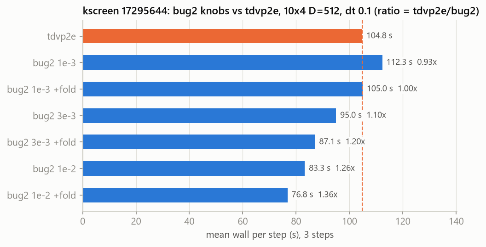
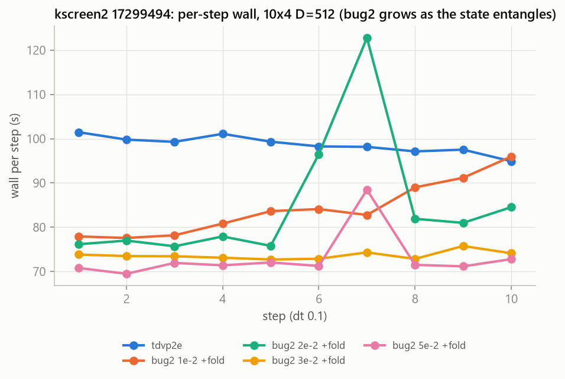
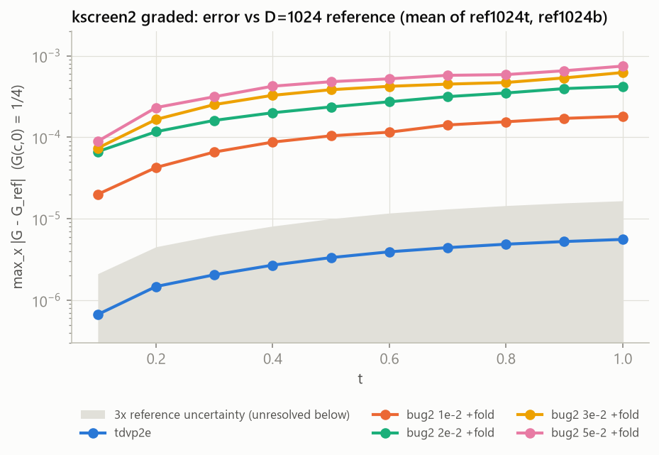
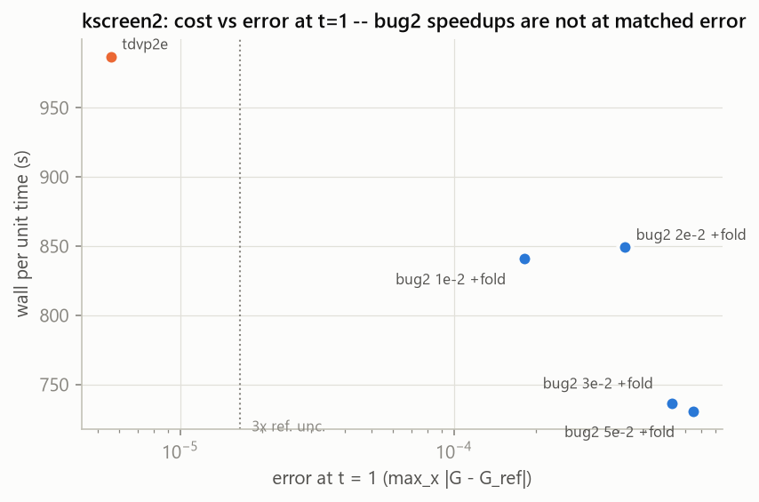
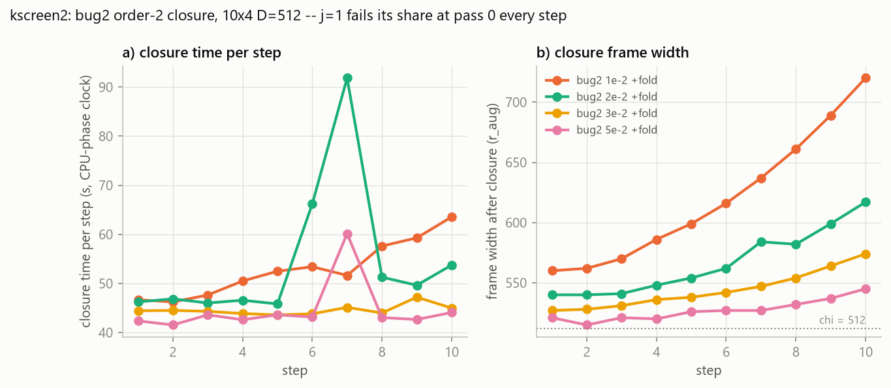
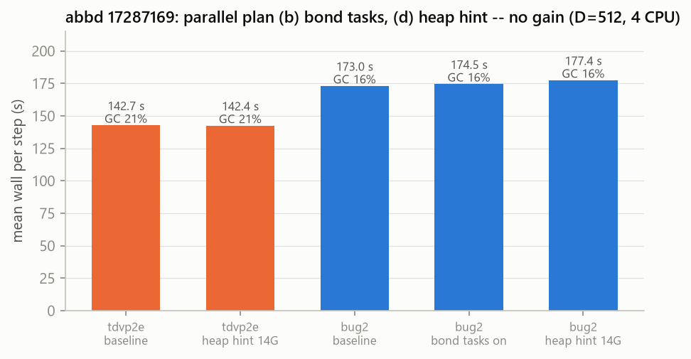
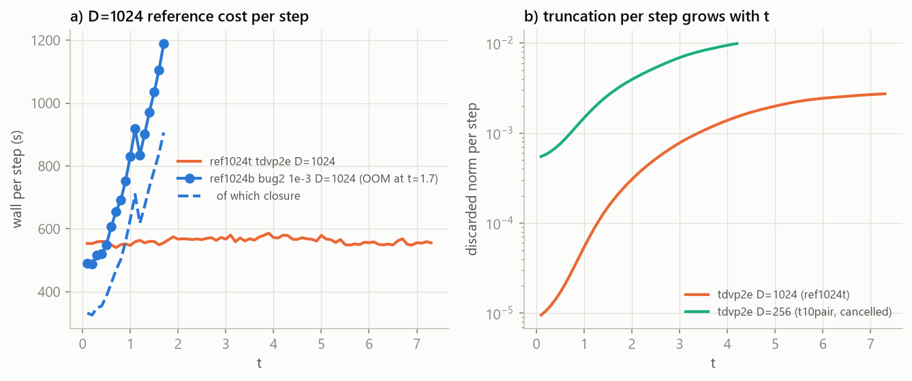
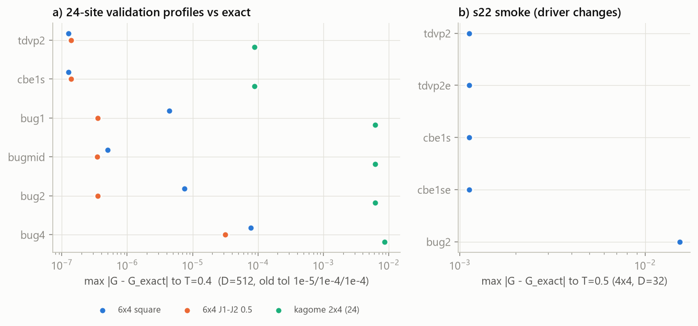
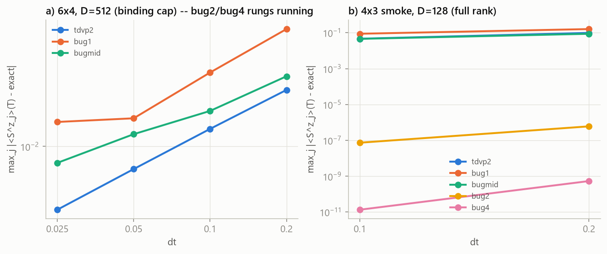

# Agent handover 5 — bug2 knob search, Phase 6 started

Date: 2026-10-17 (03:00). Repo: BUG-Julia, branch `feature/krylov-closure-order`, last commit `9e4e069`
(local, never pushed). Supersedes `AGENTS_HANDOVER_4.md`; everything still relevant from it is
restated here. Figures: `handover5_figs/` (regenerate with `handover5_figs/make_h5_figs.py DATA OUT`
from the cluster CSVs listed in §6).

---

## 0. Standing rules (all still binding)

- **Cluster:** read `../cluster_compliance.md` in full and walk its 9 gates with named evidence
  before EVERY `sbatch`.
  - `--time=7-00:00:00`; `--mem` from a measured MaxRSS + 10–20 %; exclude the cip nodes.
  - Output goes under `$SCRATCH/rsvd_adaptive/<date>-<tag>/`.
  - Gate 9 is three checks: `seffx -j`, `grep -iE 'oom|out of memory'`, and
    `grep -E 'EXIT-[A-Z0-9x-]+=[1-9]'`.
- **Run nothing locally** (Julia). Python plotting/grading locally is fine. Stage with `tar --force-local`
  of `git ls-files -co --exclude-standard` → `scp` → `~/bugjl/stage.sh ~/bugjl/<name>.tar <name>`
  (prints `SNAP`, `PKG`; a src change = new PKG = ~10 min cold precompile in the first job).
- **One timing job at a time.** Accuracy jobs may run beside it (note the node when quoting walls).
  `afterany` fires when the parent fails or is cancelled: hold the child first.
- **Fairness rules for timing** (USER, 2026-10-16):
  - timing ratios only between same-order arms at the same dt (bug2 ↔ `tdvp2_step!`; bug4 ↔
    `tdvp2_composed_step!(order = 4)`), otherwise at **matched physical error** (plan §8);
  - the same discard rule for both arms (`tdvp2_step!(...; weight_tol)` = the BUG's budget,
    driver `BP_TDVP_TRUNC=budget`);
  - `tol_trunc` = `tol_expv` = 1e-6 for both arms;
  - JIT is part of the cost;
  - 4 CPUs per arm.
- **USER 2026-10-16: bugmid is not tdvp2's partner** ("bugmid doesn't do halfsweeps"). Use bug2.
- **USER GOAL (active, /goal 2026-10-16):** "do the phase 6 plans and optimise the bug2 runs such
  that it is more efficient and there is a considerable speedup over 2site tdvp in a fair
  comparison ... if this is not obtained, then it points at not selecting the appropriate knobs."
  Memory note: `bug2-must-beat-tdvp2-considerably-it-is-a-knob-question`.
- **USER 2026-10-16: Phase 6 at tmax = 8** ("consider t=8"); the optional validations are to be done.
- **Always grade against the reference before calling a variant faster.** Infidelity vs tdvp2e hid
  a 30x accuracy loss (§3.2).
- The closure's "check first" pre-measurement stays (UT6/UT9, user-reviewed). Savings must come from
  reuse, never from skipping a check. A failing test: read the code first; a second weakening of a
  test means stop and ask.
- **Changing the closure's share rule** (handover-4 task 3) changes the plan's tolerance derivation:
  it needs user approval.

## 1. Commits this session

| commit | what |
|---|---|
| `246ecbe` | `_BOND_TASKS` default OFF (switch kept; driver `BP_BOND_TASKS` default 0; test switches tasks ON for its A/B). Verified s21test 17293204 (250/250) |
| `9e4e069` | `fig45_2209.jl` Phase 6 ready: `sz_overlaps` correlator (no N stored bras), arms `tdvp2e` (Saad stop + BUG budget discard) and `cbe1se` (Saad stop, relative cutoff = `F_TT`), per-step CSV `fig45_steps_<tag>_<arm>.csv`, `F_ARMS=none` = ground state only, absolute `F_OUT`. Smoke s22 17295294 |
| **uncommitted** (snapshot s23) | `fig45_2209.jl`: GS cached BEFORE the variance; the variance stored in the cache and reused on load; flushes after each start. **Commit once `p6sq_test` 17330122 passes** (it is the first job to load a cached variance) |

Snapshots: s21 (PKG `9f6d412f1cf5`, src = `246ecbe`), s22 (= `9e4e069`), s23 (= s22 + the uncommitted
fig45 edit). All three share PKG `9f6d412f1cf5` (only scripts changed after s21).

## 2. Decisions taken

- **Task 4 (bugmid vs tdvp2e): DROPPED** by the user. `bmpair` 17293145 was cancelled before it ran.
- **`t10pair` 17289471 CANCELLED** after 45 min, and **`tbladder` 17293138 CANCELLED** while held.
  Both used knobs the screens superseded. The fair t = 10 run must be redone with the chosen knobs.
- **No heap-size hint for either arm. Bond tasks default off** (handover-4 task 6, done; Fig. 6).
- **Kagome bridges:** a 12-site kagome *cylinder* does not exist (the builder needs Ly ≥ 3 cells;
  1x4 has no open direction), and the 18-site 2x3 was already validated. The 24-site bridge is 2x4
  (Ly = 4, so K is not allowed). **Phase 6 kagome-36 is 4x3**, the same circumference as the 18-site
  run, so K = (4π/3, 0) is allowed.
- **Phase 6 ground state = one D = 1024 state per geometry**, shared by every arm and cap
  (`F_DGS=1024`; symlink it into each run's `F_OUT`). The square 10x4 state is the
  `bug_profile_2d.jl` D = 1024 GS, re-keyed into fig45 format (`p6/gs/rekey_square.jl`, energy
  re-checked), so the Phase 6 square runs start from the same state as the D = 1024 references.

## 3. Results

### 3.1 kscreen 17295644: `tol_basis` × fold at D = 512, 3 steps

Setup: dell06, 4 CPUs, dt 0.1. Gate 9 clean, MaxRSS 5.2 G.

- Fold changes no state (infidelity 1e-14 vs no fold), cuts 7–8 s/step and lowers GC at D = 512.
- Looser `tol_basis` is faster: the best is 1e-2 + fold at 1.36x (1.37x including JIT).

### 3.2 kscreen2 17299494: fold, `tol_basis` 1e-2…5e-2, 10 steps (t = 1), graded

Setup: hua25, 4 CPUs. Gate 9 clean, MaxRSS 5.1 G.

- Over 10 steps the gain shrinks to 1.16–1.35x. bug2's step grows as the state entangles, while
  tdvp2e stays flat at ~98 s.
- The spikes at step 6–7 (2e-2, 5e-2) are extra closure passes (§3.3).

- **Graded with `matched_error.py --times 0.5,1` against the D = 1024 references:**
  - tdvp2e D = 512 has error 5.6e-6 at t = 1, below 3x the reference uncertainty;
  - bug2 + fold at `tol_basis` 1e-2 / 2e-2 / 3e-2 / 5e-2 has 1.8e-4 / 4.2e-4 / 6.2e-4 / 7.5e-4
    (≈ 0.018 × `tol_basis`).
- **None of the `tol_basis` speedups is at matched error** (30x or more worse). At matched error
  bug2 needs `tol_basis` ≲ 1e-3, where it is 0.93x.
- At t ≤ 1 the D = 512 cap barely binds (discarded ~1e-5–3e-4 per step, Fig. 7b), so tdvp2e is
  essentially exact there.

### 3.3 Why bug2's closure is the cost

- **Pass structure.** At every `tol_basis` tried, the j = 1 leak fails its share at pass 0. What
  follows is: enrich, re-check, then re-measure j = 0 (because the frames grew). That is three
  sweeps at the widened frame, ~45–64 s of a 77–96 s step. The half-sweeps cost ~45 s, under half
  of tdvp2e.
- **Growth over time.** As the state entangles, the enrichment adds more directions (97 → 919 at
  1e-2) and the frames widen (560 → 720), so every later sweep is slower.
- **Loosening backfires.** Looser `tol_basis` makes the half-sweeps capture less, so the leak grows
  almost as fast as the share. At 2e-2 the closure hugs its threshold: the enrichment stops exactly
  at the share, and the re-check (a fresh randomized estimate) fails again at a few bonds, giving 3–4
  passes that add 126, 42, 7 and 0 directions.
- **D = 1024 (ref1024b, `tol_basis` 1e-3; Fig. 7a):**
  - the closure frames reach the **2χ work ceiling (2048)**;
  - the step grows from 490 s (faster than tdvp2e's 555 s) to 1190 s by t = 1.7, then the job is
    **OOM-killed at 32 G**;
  - so the closure's cost grows faster with χ than TDVP2's.

### 3.4 abbd 17287169: bond tasks and heap hint (handover-4 task 6)

No gain from either. Bond tasks default off (`246ecbe`); no heap hint.

### 3.5 References

- **ref1024t** 17289470 (tdvp2e D = 1024, budget rule): at step 73 at 02:54, ~555 s/step, flat.
- **ref1024b** (bug2 D = 1024): OOM at t = 1.7. It is a valid reference only for t ≤ 1.7.
- **ref1536t** 17330125 (tdvp2e D = 1536, GS warm-started from the D = 1024 cache) replaces it as
  the second reference. Pairing caps 1024 and 1536 means the half-difference also measures the
  truncation error.
- tdvp2e's discarded norm per step grows with t: at D = 1024, 1e-5 at t = 0.1 and 3e-3 at t = 7; at
  D = 256 (`t10pair`), 1e-2 by t = 4.
- **Matched-error comparisons must therefore cover the whole window.** At late times tdvp2e's own
  truncation error grows, and a looser bug2 may then match it. That is untested.

### 3.6 Validation (optional 24-site profiles and the s22 smoke)

- **Profiles:** 17296542–44, T = 0.4, D = 512, all six arms vs exact sparse (dim 2.7M,
  `F_EXACT_N=24`), at the OLD validation tolerances 1e-5 / 1e-4 / 1e-4. MaxRSS: square 7.9 G,
  J1-J2 13.2 G, kagome 9.7 G.
- **Square and J1-J2:** all arms are good (TDVP ~1.3e-7, BUG ≤ 7.5e-6).
- **Kagome 2x4:**
  - the D = 512 GS is 3e-4 above exact (small gap, E1 − E0 ≈ 0.008);
  - TDVP is at 8.9e-5 vs exact while the BUG arms are at 6e-3;
  - the cause is `tol_trunc` 1e-4 at a binding cap. **The production validation must use
    `tol_trunc` = `tol_expv` = 1e-6.**
- **s22 smoke** (4x4, D = 32): all four TDVP-family arms agree (1.1e-3, the D = 32 GS floor); bug2 is
  at 1.5e-2 (binding D = 32, known).

### 3.7 Order ladders (`ol2d` 17282573, handover-4 task 5)

- **6x4, D = 512 vs exact:**
  - tdvp2 has slopes 0.95–0.99, first order at a binding cap;
  - bug1 has 1.06, 1.11, then flattens;
  - bugmid has 0.84, 0.57, 0.70.
- **The bug2 rung has been running for 18 h.** It uses tight tolerances (1e-10 / 1e-12 / 1e-13) on
  a binding cap, where the closure cannot close, on an OLD PKG `24aa136cbddb` (before the closure
  cache). It is progressing (~1.8 of 2 cores busy).
  - If it is still on bug2 at the next check, cancel it and rerun only bug2/bug4 on the current PKG.
- **4x3 smoke (full rank):** bug2 slope 3.0, bug4 5.3, with errors far below the fixed-frame
  schemes.

### 3.8 Phase 6 ground states (D = 1024, `2026-10-16-p6/gs/<geom>/`)

| geometry | E0 / N | variance | starts | status |
|---|---|---|---|---|
| square 10x4 | −0.6665065644 | 1.34e-8 | 1 (re-keyed bp GS) | **done** (17305631; the variance alone peaked at **12.8 G**) |
| J1-J2 10x4, J2 = 0.5 | −0.5199384689 | 6.22e-9 | 3, spread 2e-13 | **done** (solve 17305632 in 82 min; variance 17330121, peak **19.9 G**) |
| kagome 4x3 (36) | start 1: −15.584169452 (−0.43289 per site) | pending | 3 | running 17305633 on s23 at 16 G (start 1 took 6.4 h; ~20 h total). Its variance (w = 20) needs ~26 G (12.8 G × (20/14)²), so it will OOM AFTER the state is cached (s23 saves first). Then rerun the variance-only job (`gs_kagome.sbatch`, loads the cache) at **32 G** |

The square GS job was OOM-killed twice (6 G, 12 G) by the variance's two-layer environment at χ = 1024
(χ²w² per bond). That led to the s23 fix (cache first, variance cached).

## 4. Jobs at handover (2026-10-17 02:54)

| job | what | dir | when it ends |
|---|---|---|---|
| **17330119 `pareto`** (TIMING) | tdvp2e vs bug2 + fold `tol_basis` {1e-3, 3e-3} at dt {0.2, 0.1, 0.05} to t = 1, D = 512, one process per dt (subdirs dt2/dt1/dt05), G recorded | `2026-10-17-pareto/` | gate 9; grade each subdir with `matched_error.py --times 0.5,1`; plot cost vs error per dt. This tests the **dt knob**: bug2 at larger dt at matched error |
| 17330122 `p6sq_test` | square 10x4, cached GS + variance, arms tdvp2e, cbe1se, bug2 at D = 1024, 2 steps; per-arm MaxRSS (`/usr/bin/time -v`) | `p6/square/test/` | gate 9; size the nine square production jobs from the per-arm MaxRSS; commit the s23 fig45 change |
| 17330125 `ref1536t` | second reference, tdvp2e D = 1536 to t = 10 (16 G, first of class) | `2026-10-17-ref1536/` | ~2 days. Then the references are ref1024t + ref1536t |
| 17289470 `ref1024t` | first reference, tdvp2e D = 1024, t = 10 | `2026-10-16-ref1024/tdvp2e/` | ~4 h left at 02:54 |
| 17305633 `p6gs_kagome` | kagome 4x3 GS, 3 starts (s23, 16 G) | `p6/gs/kagome/` | ~11 h left; expect an OOM in the variance after the state is cached; rerun the variance-only job at 32 G |
| 17282573 `ol2d` | 6x4 order ladder, bug2 rung | `2026-10-16-order/` | see §3.7 |

### 4b. Update 2026-10-17 11:30

- **ref1024t COMPLETED** (t = 10).
- **p6sq_test 17330122: passed.** Gate 9 is clean and the cached variance was reused. Per-arm
  MaxRSS at D = 1024: tdvp2e 4.2 G, cbe1se 4.5 G, bug2 12.2 G. On the same node, bug2 (1e-3, no
  fold) took 1717 s/step vs tdvp2e's 2670 s/step at steps 1–2 (1.56x), before its frames grow.
  The fig45 change is committed as `8cd253b`.
- **pareto 17330119 OOM at 7 G** in all three processes (bug2 arm) -> resubmitted as **17331886**
  at 12 G (old outputs in `oom7G_17330119/`).
- **ref1536t 17330125 cancelled** after 8 h 50 on th-cl-dell03 at ~9000 s/step. The node was
  contended: tdvp2e D = 1024 ran there at 2670 s/step against 555 s/step on edger. Resubmitted as
  **17331887** excluding dell03; the D = 1536 GS is cached.
- `ol2d` 17282573 was cancelled at 22.5 h, by the user (not by an agent).
- **Phase 6 square production submitted** (`p6/square/D<cap>/<arm>/`, T = 8, dt 0.05,
  `F_ETA2=0.045`):
  - tdvp2e at 256/512/1024 (17331888, 17331890, 17331892);
  - cbe1se at 256/512/1024 (17331889, 17331891, 17331893);
  - bug2 at 256/512 (17331894, 17331895).
  - **bug2 D = 1024 is deferred** until the closure question (§7 item 1) is settled: its frames
    reach 2χ, giving more than 32 G and more than 1190 s/step.
- J1-J2 Phase 6 runs still need a 2-step test job first (MPO w = 17, a larger class than the
  square).

## 5. Traps found this session

1. **seffx/sacct MaxRSS misses the OOM spike** (square GS: sampled 4.2 G, killed at 6 G and 12 G).
   Size from a job that *survived* the spike (the variance: 12.8 G square, 19.9 G J1-J2).
2. **Julia stdout to a file is block-buffered**: a 30-min solve printed nothing. fig45 now flushes
   after each start and after the GS line.
3. **GNU tar on Windows reads `C:` as a remote host**: use `tar --force-local`.
4. **Kagome cylinders need Ly ≥ 3**: `kagome 2 2` throws.
5. **A short screen overstates bug2's gain**: bug2's per-step cost grows with t, tdvp2e's does not.
   Screen at least 10 steps, better to t = 10.
6. Earlier validation sbatches used a relative `F_OUT`, which wrote into `~/bugjl/snap/s3/results`
   (in `$HOME`, a gate-8 violation). Always pass an absolute `F_OUT` under `$SCRATCH`.

## 6. Where things are

- Handover data for the figures (cluster paths under `$SCRATCH/rsvd_adaptive/`):
  - `2026-10-16-kscr/`
  - `2026-10-16-kscr2/`
  - `2026-10-16-abbd/p{0,1,2}/`
  - `2026-10-16-ref1024/{tdvp2e,bug2}/`
  - `2026-10-16-val24/prof/*/`
  - `2026-10-16-s22/sq/`
  - `2026-10-16-order/`
  - `2026-10-16-t10/`
- Drivers:
  - timing and profiling: `benchmarks/spectral/bug_profile_2d.jl`;
  - spectra, validation, Phase 6: `benchmarks/spectral/fig45_2209.jl`;
  - grading: `benchmarks/spectral/matched_error.py`.
- Closure: `src/RSVDCBEBondUpdate/sweeps/krylov_closure.jl`. The per-bond share is
  `tol_basis/sqrt((L−1)·order)` (`basis_allocation`, `adaptive_budget.jl`).
- Phase 6 tree: `$SCRATCH/rsvd_adaptive/2026-10-16-p6/` (`gs/<geom>/` caches,
  `gs/rekey_square.jl`, `square/test/`).
- Memory notes: `bug2-must-beat-tdvp2-considerably-it-is-a-knob-question`,
  `phase-6-pilot-matched-error-pipeline`, `timing-ratios-only-between-same-order-arms`,
  `bug-large-chi-rsvd-tol-loose-others-tight`.

## 7. Next tasks (in order)

1. **bug2 speedup (the active goal): not achieved yet.**
   - Read the `pareto` front (dt knob). If bug2 keeps its accuracy at larger dt while tdvp2e loses
     it, a matched-error speedup follows.
   - If not, the remaining lever is the closure's share rule at a binding cap (handover-4 task 3).
     It changes the plan's tolerance derivation, so ask the user first.
   - Then the fair t = 10 run with the chosen settings (both arms in one process, G recorded).
2. **Phase 6 production (tmax = 8, dt 0.05, `F_ETA2=0.045`, `F_TT`=`F_TE`=1e-6):**
   - square, J1-J2 and kagome-36 evolutions at caps 256 / 512 / 1024 with tdvp2e, cbe1se and bug2
     (one job per geometry, cap and arm, the GS symlinked into each `F_OUT`);
   - S(q,ω) and the §8 performance figures from those runs.
3. **Optional validation production runs:** 24-site T = 8 runs (6x4 square, 6x4 J1-J2, kagome 2x4)
   against exact, with production tolerances, sized from §3.6's MaxRSS.
4. **Handover-4 task 2:** the fair t = 10 timing and matched-error grading. It needs item 1's knobs
   and both references (ref1024t + ref1536t).
5. **Handover-4 task 5:** read the `ol2d` bug2/bug4 slopes (or rerun on the current PKG), set U22 in
   `SIMULATION_PLAN_2_AUDIT.md`, finish the order section of `TASK4_VALIDATION_RESULTS.md`, and
   commit with `benchmarks/spectral/order_ladder_2d.jl`.
6. **Handover-4 task 7:** profile the bug1 part of the step, after the closure work.
7. **Open flag:** `cbe1s` has no budgeted discard rule (it keeps a relative cutoff), so its
   comparison is not on equal truncation terms.
